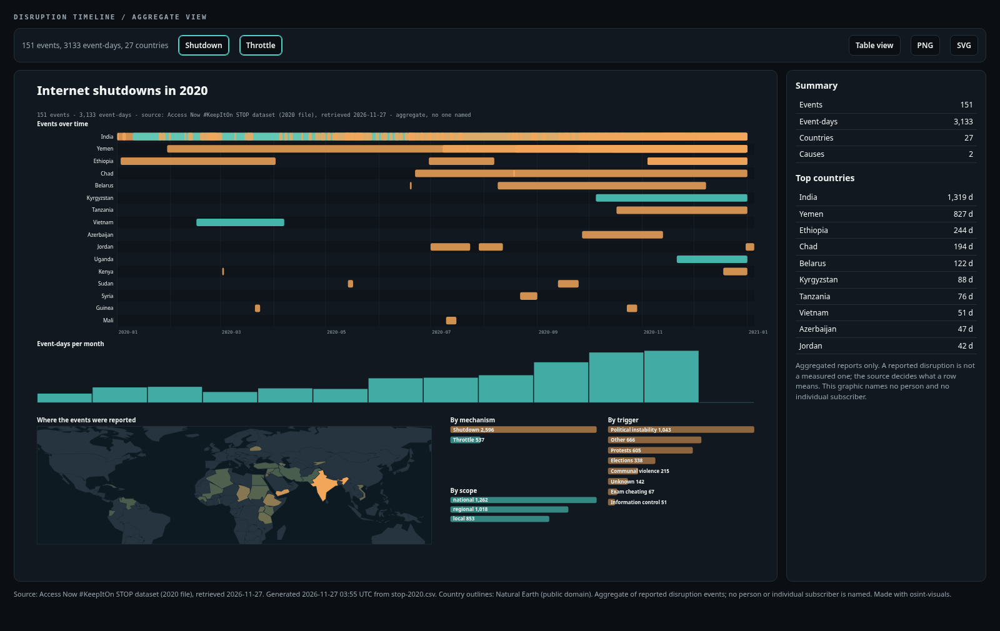
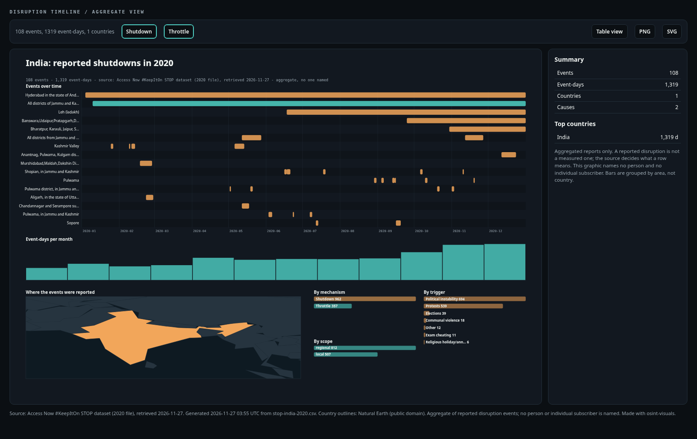

# osint-visuals

**Evidence graphics for open-source investigations, made by your AI agent.** Ask in plain words and get a
publication-ready visual that carries its own sources: an animated ship track that flags where it went dark, a shadow
diagram that tests a claimed time, a 3D miniature of the scene with the camera's line of sight, a newsroom locator
map, a before-and-after satellite slider, a whole scrolling map story, or a network of who is linked to whom where
every connection opens the records behind it.

Eight skills in the open [Agent Skills](https://agentskills.io) format, for Claude Code and other agents. Each one
writes **a single HTML file**. The seven graphics have export built in: PNG for all seven, WebM video for track-map,
scene-diorama and before-after, SVG for shadow-diagram, locator-map and outage-timeline. The scroll story can also be written as a
Svelte 5 project for a newsroom's own build. Python 3.9+, standard library only, no API keys. Time zones: `--tz` takes an offset like +04:00 or a
zone name like Asia/Dubai; with a name, track-map's clock follows daylight-saving changes (on Windows, names need
`pip install tzdata`).

| | |
|---|---|
|  |  |
| **track-map**: AIS or ADS-B positions become an animated map that labels signal gaps, who was nearby when a ship went dark, ships side by side at sea and positions out of line. | **scene-diorama**: a real place from OpenStreetMap as a miniature, with where the camera stood, what it could see and how far away the event was. |
|  |  |
| **shadow-diagram**: when could this shadow have been cast? The windows that fit, and a claimed time tested against them. | **locator-map**: a clean "where is this" map from a place name, in web, social and print sizes. |
|  |  |
| **before-after**: a slider readers can drag, from free NASA imagery (the clearest pass near each date is picked for you) or your own licensed images. | **scroll-story**: a plain-text script becomes a scrolling story: the map flies between places, pictures change, the before/after divider moves with the scroll. Also as a Svelte project. |
|  |  |
| **network-graph**: people, organisations, places or any types you define, linked only by connections you supply, each one backed by records you can open, which can hold the quote, where it is in the source, and what is uncertain. Search, filters, one- or two-step neighbourhoods and a table view; save the current view as JSON. Works offline. | Names and quotes in many scripts, including Arabic and Hebrew written right to left; the interface stays in English. [Open the demo](examples/network/demo.html) or [the multilingual one](examples/network/multilingual.html). |
|  |  |
| **outage-timeline**: dated disruption events become a Gantt timeline by country or area, with event-days per month, a country map, a mechanism and trigger breakdown, open-ended bars and the source on the graphic. | The same public data grouped by area, for a single country. Example data: Access Now #KeepItOn STOP, credited on the page. |


*The diorama's camera's view: the scene from where the footage was filmed, to compare with the frame.*

The track, shadow, diorama and locator examples use invented scenarios (fictional ships, claims and events) on real
maps. The before-after and scroll-story examples use real NASA imagery of Lahaina, Maui, before and after the
wildfire of 8 August 2023. The outage examples use real public data from the Access Now #KeepItOn STOP dataset,
credited on the graphic.
The network examples are entirely fictional: every name, record and quote.

## Why

Investigations are often published with a screenshot of a map and a paragraph of explanation. Readers trust what they
can see. These skills make the graphic that shows the method, and they put the evidence trail on the graphic itself:
where the data came from, the thresholds used, and what a finding does and does not show. They also keep the agent
from overclaiming: a gap is "no reports for 31 hours", not "switched off its transponder".

## Install

**Claude Code, for yourself:**

```
git clone https://github.com/Ghongha007/osint-visuals.git
mkdir -p ~/.claude/skills
cp -r osint-visuals/skills/* ~/.claude/skills/
```

**Claude Code, for one project:** copy the folders into `.claude/skills/` in that project.

**Other agents:** copy the folders to wherever your agent reads skills from. Each skill is self-contained.

Then ask, for example:

- "Map this AIS export and show where the tanker went dark" (attach the CSV)
- "Make a shadow diagram: Nairobi, 10 August, shadow pointing 250 degrees, the post claims 4:30 pm"
- "Build a diorama of Prešeren Square in Ljubljana with the camera on the first floor at 46.05098, 14.50712 looking at
  the crowd at 46.05143, 14.50606"
- "Locator map for Beira, Mozambique, 4:5 for Instagram"
- "Make an offline relationship network from this JSON, with sources behind each connection"

## Works with

The skills follow the open [Agent Skills](https://agentskills.io) format, so any agent that reads `SKILL.md` folders
and can run a terminal command can use them. Checked against each tool's own documentation in November 2026:

| Agent | Put the skill folders in | Cost (at the time of writing) |
|---|---|---|
| [Claude Code](https://code.claude.com/docs/en/skills) | `~/.claude/skills/` or a project's `.claude/skills/` | Paid plan or API key |
| [Claude.ai](https://support.claude.com/en/articles/12512180) (web and apps) | Upload a skill folder as a ZIP under Customize > Skills, with code execution turned on | Free plan included |
| [OpenCode](https://opencode.ai/docs/skills/) | `~/.config/opencode/skills/` or `~/.agents/skills/` (also reads `~/.claude/skills/`) | Open source (MIT); some free models, for a limited time |
| [Antigravity CLI](https://antigravity.google/docs/skills) (Google) | `~/.gemini/config/skills/` or a project's `.agents/skills/` | Free individual tier with a weekly quota |
| [Goose](https://goose-docs.ai/docs/guides/context-engineering/using-skills/) (Agentic AI Foundation) | `~/.agents/skills/` | Open source (Apache-2.0); bring your own model, including a free local one |
| [Codex CLI](https://learn.chatgpt.com/docs/build-skills) (OpenAI) | `~/.agents/skills/` or a project's `.agents/skills/` | Open source CLI; ChatGPT plan (Free included) or API key |
| [GitHub Copilot](https://docs.github.com/en/copilot/concepts/agents/about-agent-skills) (CLI, VS Code agent mode) | `~/.agents/skills/`, `~/.copilot/skills/` or a project's `.github/skills/` | Free plan with limited agent use; paid plans from $10/month |
| [Cursor](https://cursor.com/docs/context/skills) | `~/.agents/skills/` or `~/.cursor/skills/` | Free plan with limited agent requests; paid from $8/month |
| [Cline](https://docs.cline.bot/features/skills), [Kilo Code](https://kilo.ai/docs/agent-behavior/skills) (VS Code) | `~/.cline/skills/`; `~/.kilo/skills/` or `~/.agents/skills/` | Open source; bring your own model key |

**The most portable folder is `~/.agents/skills/`**: most of these agents read it (Claude Code reads `~/.claude/skills/`,
Cline `~/.cline/skills/`, Antigravity `~/.gemini/config/skills/`).

```
mkdir -p ~/.agents/skills
cp -r osint-visuals/skills/* ~/.agents/skills/
```

On Claude.ai the scripts run in Claude's cloud sandbox, so you download the HTML files it writes. track-map,
shadow-diagram and scroll-story need no data downloads. scene-diorama, locator-map and before-after fetch map and
imagery data, so on Claude.ai they need full internet access: the sandbox only reaches package managers by default,
so turn on "Allow network egress" in Settings > Capabilities (on Team and Enterprise plans, an owner sets it).

With no agent at all, the scripts still work: see below.

## The scripts work without an agent

```
python3 skills/track-map/scripts/track.py examples/track/demo-tankers.csv --title "A tanker goes dark" --tz +04:00
python3 skills/shadow-diagram/scripts/shadow.py --lat -1.2864 --lon 36.8172 --date 2026-08-10 --tz +03:00 \
    --shadow-azimuth 250 --tolerance 6 --height 1.75 --shadow-length 2.3 --claimed 16:30
python3 skills/scene-diorama/scripts/diorama.py --lat 46.0514 --lon 14.5061 --radius 110 \
    --camera 46.05098,14.50712 --camera-height 9 --target 46.05143,14.50606
python3 skills/locator-map/scripts/locator.py --place "Beira, Mozambique" --title "Cyclone makes landfall near Beira"
python3 skills/before-after/scripts/before_after.py --lat 20.873 --lon -156.677 --km 1.8 \
    --before 2023-08-05 --after 2023-08-10 --title "Lahaina before and after the fire"
python3 skills/scroll-story/scripts/story.py examples/scroll-story/demo.md --svelte story-app/
python3 skills/network-graph/scripts/network.py --input skills/network-graph/assets/demo.json --output network.html
python3 skills/outage-timeline/scripts/outage.py examples/outage/stop-2020.csv --date-format us \
    --snapshot 2020-12-31 --title "Internet shutdowns in 2020" \
    --source "Access Now #KeepItOn STOP dataset (2020 file)"
```

Each prints what it found (gaps, windows, matches) and writes the page. Open it in a browser, pick a frame (16:9, 1:1,
4:5 or 9:16 Reel; locator-map also has 3:2 web and print) and export. The track, diorama, locator and scroll-story pages load
pinned libraries (MapLibre, three.js, d3) from unpkg, each with a fingerprint that current browsers check (the
diorama's needs a recent browser), so a file that has been changed is refused. The track map and the scroll story's map steps load tiles from
OpenFreeMap, so they need a connection when opened. The shadow and before-after pages are fully self-contained
(before-after embeds both images). The scroll story's Svelte project needs Node 20.19+, 22.12+ or 24+ to build (Vite 8's requirement).

The network page carries its own copy of the vis-network library, checked against a fixed fingerprint, so it works
offline; only clicking a link goes online. Next to the page it writes the graph as JSON; a saved view holds the filters and layout, not the records. The input format is
in its [schema reference](skills/network-graph/references/schema-and-build.md).

## Data, and the rules that come with it

| Used by | Source | Licence and rules |
|---|---|---|
| track-map | your CSV; basemap from [OpenFreeMap](https://openfreemap.org) | Map: OpenFreeMap © OpenMapTiles, data © OpenStreetMap contributors (credit is drawn on every export). Your data's own terms apply. |
| scene-diorama | [Overpass API](https://overpass-api.de) (OpenStreetMap) | ODbL: credit "© OpenStreetMap contributors". One request per place (up to two retries if the server is busy), cached; Overpass is shared, so no bulk loops. |
| locator-map | [Natural Earth](https://www.naturalearthdata.com), [Nominatim](https://nominatim.org) | Natural Earth is public domain. Nominatim: max 1 request per second, identifying User-Agent, results cached ([policy](https://operations.osmfoundation.org/policies/nominatim/)). |
| outage-timeline | your table; example from [Access Now #KeepItOn STOP](https://www.accessnow.org/keepiton-data-dashboard/); outlines from [Natural Earth](https://www.naturalearthdata.com) | Your data's own terms apply. STOP is public data intended for reuse with attribution to Access Now and the #KeepItOn coalition; check the terms on the file you download. Natural Earth is public domain. |
| shadow-diagram | none | Sun positions computed locally (NOAA equations). |
| before-after | your images, or [NASA GIBS](https://www.earthdata.nasa.gov/gibs) (HLS, VIIRS, MODIS) | Keyless; the graphic credits NASA GIBS and, for HLS Sentinel-2, "contains modified Copernicus Sentinel data". The date search fetches up to one small preview per day, from the asked-for date out to 12 days before or after (`--window`), stopping early at a clear pass; cached. Your own images: their owner's terms. |
| scroll-story | your script and images; map steps from OpenFreeMap | Map credit in the page's sources footer; every image needs its own credit. |
| network-graph | your JSON and its records | Your sources' own terms apply. The bundled vis-network library is MIT or Apache-2.0 ([notices](skills/network-graph/assets/vendor/NOTICE.md)). |

The scripts' downloads are cached in `~/.cache/osint-visuals` and never expire; delete a file there to fetch fresh
OpenStreetMap data. The scripts send an identifying User-Agent and only what each lookup needs (the place name, or the
area's coordinates) to OpenStreetMap's servers. Opening a page fetches libraries and tiles from third-party servers,
which see your IP address and the area you are viewing: keep that in mind for sensitive investigations.

## What these skills will not do

- Track, map or model a private person: their home, their movements, the window they filmed from.
- Present an inference as a finding: a meeting at sea is not a transfer, a matching shadow is not proof of a time, and
  the camera's view is an approximation, not a photograph.

These limits are written into the skills. If you fork the pack, please keep them.

## Limits

- Lines between track reports are straight; the real path, above all across a gap, is unknown.
- The diorama's heights come from OpenStreetMap tags or are estimated from the building type; roofs and terrain are
  flat. Check it against satellite imagery before you publish.
- The shadow maths ignores refraction, so it is unreliable within about 3 degrees of the horizon.
- Locator and outage-map borders follow Natural Earth's de facto lines. For disputed areas, follow your outlet's style guide.
- In outage-timeline, a bar is a reported event, not a measurement. An open bar runs to the snapshot date, and overlapping events on the same day count twice; say both when you publish.
- Free NASA HLS imagery is 30 m a pixel: single buildings are not visible, and some places (remote islands, some ocean
  areas) have no data on many dates. For detail, use licensed commercial imagery with `--before-image`/`--after-image`.
- In the network graph, where a node sits means nothing: the layout is physics, not geography or importance. A
  record marked `recorded` has a source attached, which is not the same as being proven. Filters only hide
  things: the page and its JSON still hold everything you put in, so remove sensitive records before sharing.

## Tests

```
python3 -m unittest discover -s tests
```

The tests run offline: track analysis on the regenerated demo data, the sun position against a known value (London's
noon sun at the December solstice), the shadow windows and claim check, page writing for track, shadow and
before-after, the diorama and locator geometry helpers, the PNG reader and cloud score used to pick clear satellite
passes, the scroll-story parser, its text escaping and its Svelte export, and that text in your data cannot break
out of the page and run as code. They run automatically on every pull request, on Python 3.9 and 3.13.

The network tests check its input rules (every connection needs a record, no unsafe links), its escaping, the
library fingerprint and that it never overwrites an earlier file. An optional [browser check](skills/network-graph/references/schema-and-build.md#commands) and the
[network security review](docs/network-security-review.md) say what else was tested.

## Related

- [photo-time-check](https://github.com/Ghongha007/photo-time-check): when could this photo have been taken? Metadata and shadows
- [osint-skills](https://github.com/Ghongha007/osint-skills): verification skills (geolocate, chronolocate, archive evidence, attribute claims)
- [groundline](https://github.com/Ghongha007/groundline): check every sentence of a draft against its source documents
- [verify-mcp](https://github.com/Ghongha007/verify-mcp): an MCP server with keyless, read-only verification lookups
- [aitrace](https://github.com/Ghongha007/aitrace): check an image or video for traces of AI generation

## Licence

MIT. Made by [OSINT JOURNO](https://github.com/OSINT-JOURNO).

network-graph contributed by [thomasjjj](https://github.com/thomasjjj).
